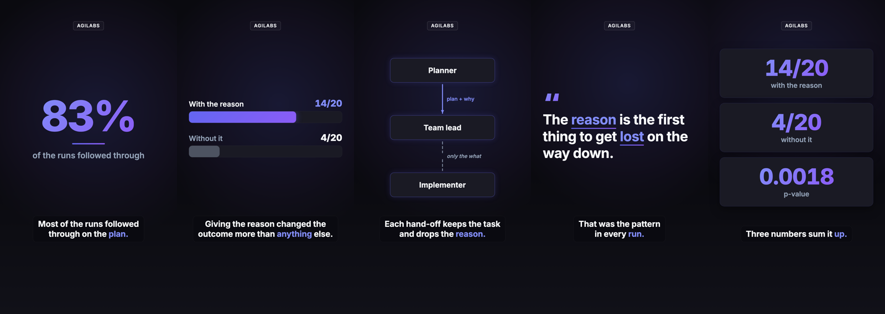

# agilabs-video-studio

A Claude Code plugin that turns a blog article into a short, narrated, animated vertical
explainer video. Claude reads the article, writes a 30-60 second script with a hook, the
experiment and the finding with its exact number, and proposes a visual for every scene. Once
you approve the script, it builds the scenes from a library of animated components (counters,
bar comparisons, flow diagrams, key quotes, stat tiles), voices the narration with word-level
timestamps, burns in karaoke captions so the video works muted, adds a ducked music bed and
renders a 1080x1920 MP4 plus poster and SRT, locally, with Remotion, in the AGILabs brand.



## Install

In Claude Code:

```
/plugin marketplace add JaviMaligno/agilabs-video-studio
/plugin install agilabs-video-studio@agilabs-video-studio
```

Then ask for it: "make a video of this article: <path or URL>".

## Requirements

- Node.js 23.6 or newer (TypeScript runs natively)
- ffmpeg on the `PATH` (or `FFMPEG_PATH`)
- python3 with numpy, or [uv](https://docs.astral.sh/uv/), for the music bed and the local voice
- A [Cartesia](https://cartesia.ai) API key, optional: without one the narration uses the local
  Kokoro voice

## Skills

| Skill | What it does |
|---|---|
| `article-video` | The whole path: pick the article, script, approval, scenes, narration, QA, stills, render, delivery |
| `explainer-script` | The script: hook within 3 s, structure, 75-140 words, caption reading speed, EN/ES pair, a visual per scene |
| `explainer-animation` | The timeline, the component catalogue, bespoke components with tested frame states, safe areas, stills |
| `narration` | Cartesia TTS, Kokoro fallback, pronunciation, Spanish voice, audio QA thresholds |

## Quickstart without Claude

The Remotion project is in [`template/`](template/). Copy it to a folder of its own per video:

```bash
rsync -a --exclude node_modules --exclude out template/ my-video/
cd my-video
npm ci
cp .env.example .env          # optional: add CARTESIA_API_KEY
# edit src/settings.ts and src/timeline.ts
npm run lint                  # length, caption speed, unknown components
npm run tts                   # narration (Cartesia, or Kokoro without a key)
npm run audio-qa              # clipping and garbled lines
npm run studio                # preview in the browser
npm run render                # out/main-en-vertical.mp4, normalised to -16 LUFS
npm run deliver               # poster, SRT and out/manifest.json
```

`npm test` runs the unit tests (timeline, captions, components, lint, music, TTS engine choice).

## Remotion licence

The template is built on [Remotion](https://www.remotion.dev), which has its own licence:
free for individuals and small teams, while companies above Remotion's size threshold need a
Remotion company licence. See [remotion.dev/license](https://www.remotion.dev/license) before
using this plugin at work.

## Licence

MIT, © AGILabs. More at [javieraguilar.ai](https://javieraguilar.ai).
